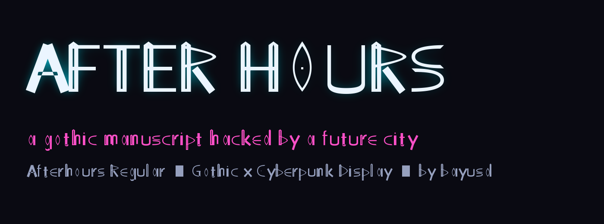
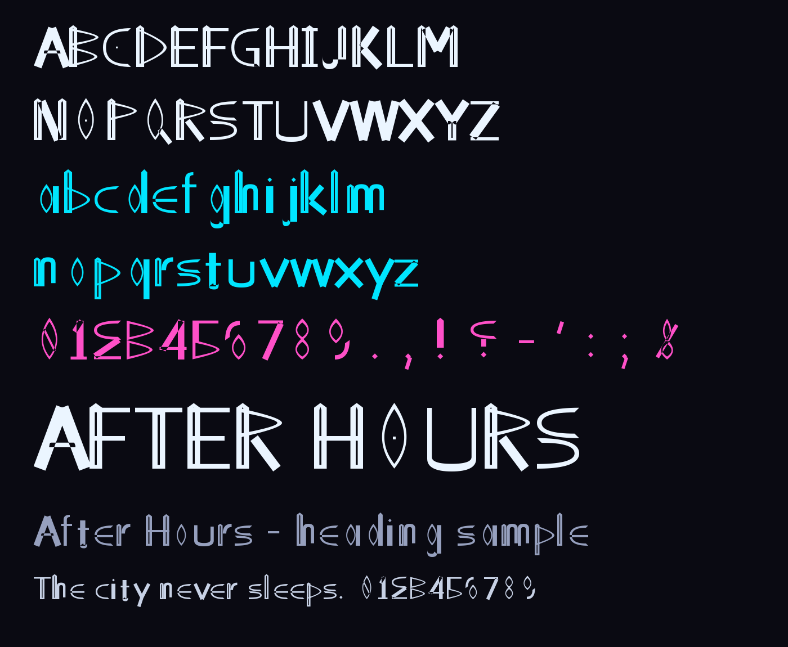

# Afterhours — Gothic x Cyberpunk Display Font

**Afterhours Regular** is an original Latin display font: a Gothic manuscript
hacked by a city from the future. Pointed-arch blackletter bones, dramatic
thick/thin contrast and sharp terminals, charged with cyberpunk energy —
a neon inline slit running through every stem and circuit-node counters
punched into the letterforms. Dark, electric, a little playful, and still
readable on a phone.



## Download

- **Font file (working .otf):** [Afterhours-Regular.otf](Afterhours-Regular.otf)
  — also mirrored on the preview page: https://bayusd.github.io/afterhours-font/
- **Specimen:** [preview-specimen.png](preview-specimen.png)

## The system (consistent rules)

1. **Pointed arch, everywhere.** Every stem ends in a gothic peak; every
   round letter (O, C, D, Q, 0, 6, 8, 9) is a vesica — two curves meeting
   at a sharp point top and bottom, never a plain circle.
2. **Neon inline.** A 24-unit slit runs the length of every straight stem,
   echoing the arch peak at the top — the "neon tube" inside the letter.
3. **Circuit nodes.** Small square counters sit inside selected stems and
   bowls (A, C, O) like solder points on a board.
4. **Glitch cuts.** Diagonals (K, R, X, Y, Z, 2, 4, 7) are cut at hard
   angles with no curves, against the arches.
5. **One weight, two voices.** The same skeleton renders an expressive
   neon hero (light on near-black, cyan glow) and a quieter flat heading
   (light grey on dark) — see the specimen.



## Coverage

- **Supported:** A–Z, a–z, 0–9, space and `. , ! ? - ' : ; &` (72 characters).
- **Incomplete, labelled:** no accented / non-Latin characters, no other
  punctuation, no ligatures or kerning pairs yet. Cap height 720, x-height
  500 (UPM 1000). The slashed zero (`0`) is deliberate.

## Design choices (in 3 sentences)

The brief asked for Gothic bones with cyberpunk energy, so the skeleton is
pure blackletter — pointed arches and high-contrast strokes — while the
cyberpunk lives in the details: a neon slit inside every stem and circuit
nodes instead of decoration. I kept the system to five repeatable rules so
the style holds across caps, lowercase and numerals instead of decorating
one word. It is drawn from scratch as parametric vector outlines
(`build_font.py`, fontTools) — no existing typeface was traced or used
as a base.

## Build

```sh
python3 build_font.py   # writes Afterhours-Regular.otf
python3 render.py       # writes preview-hero.png / preview-specimen.png
```

## License

Free to use and adapt, including on a personal website, with credit to
`bayusd`. See [LICENSE.md](LICENSE.md). Original work, drawn from scratch
for the Taskmarket bounty TSK-1ZQ87Q8M.
